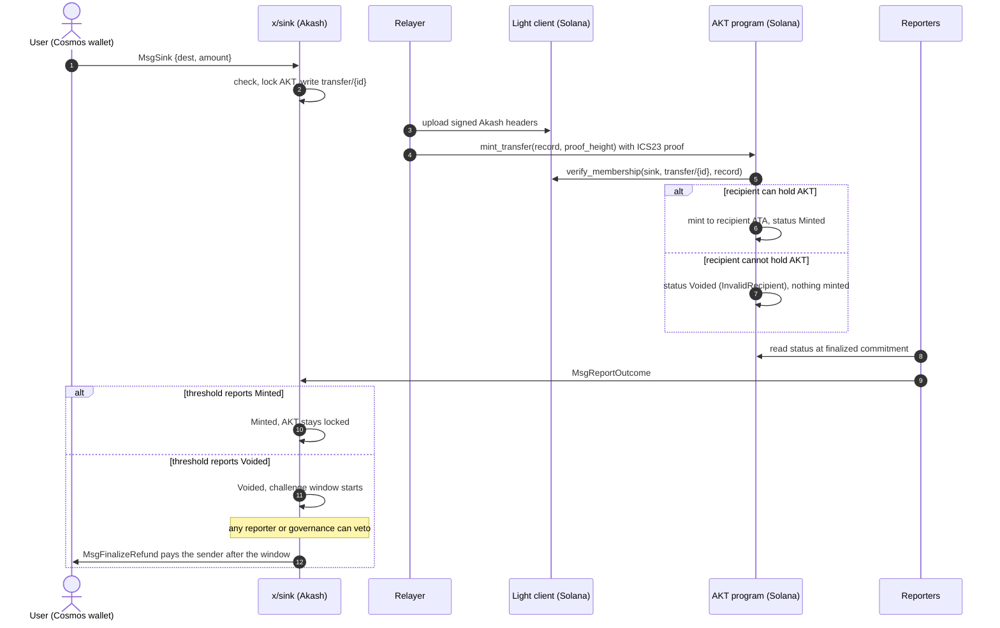

## Summary

This AEP lets AKT holders move tokens from Akash to Solana. It is the first step of the Akash chain's migration to Solana (see [AEP-79](../aep-79) and its [Chain Migration Program document set](../aep-79/doc/README.md)).

1. The user signs `MsgSink` on Akash with an amount and a Solana wallet address.
2. A new module, `x/sink`, locks the AKT and writes a fixed 77-byte transfer record into its store.
3. A relayer proves that record to the AKT program on Solana. An Akash light client running on Solana checks the proof, so the mint is authorized by the signatures of Akash's own validators.
4. The AKT program mints the same amount of SPL AKT, once per record. If the recipient cannot hold AKT, it marks the record voided instead.
5. Reporters read the outcome on Solana and report it to Akash. A mint closes the record. A void refunds the sender after a challenge window.

The Solana token launches before the Akash upgrade. Its genesis mints 1,000,000 AKT once into a treasury for initial liquidity. The Akash upgrade that adds `x/sink` locks 1,000,000 AKT from an earmarked OCL account as the launch reserve that backs that genesis supply. From then on, every AKT on Solana is backed by AKT locked in `x/sink`.

During the launch phase the Solana token is for transfer and DEX liquidity only. It has no staking or governance rights. Inflation and BME stay on Akash, so total supply keeps following Akash's schedule.

## Motivation

AKT is launching on Solana as the first step of the Akash chain's migration, ahead of any protocol functionality moving there. The immediate goal is market access: Solana has the deepest DEX liquidity and the widest wallet distribution for DePIN assets, and AKT holders should be able to trade there against SOL and USDC without a wrapped-asset intermediary.

The path is one-way on purpose. SPL AKT is the canonical token on Solana from here on, there is no need to move it back, and leaving out the return direction removes the largest class of bridge attacks. Locking instead of burning leaves Akash supply accounting unchanged and makes a refund a plain bank transfer.

This AEP covers the launch phase only. Staking, governance, BME and emissions on Solana belong to a later AEP.

## Constraints and scope

These are fixed inputs to the design.

1. The token launches on Solana first. Transfers are one-way, user-initiated, Akash to Solana. There is no return path.
2. AKT moved to Solana is locked on Akash in a new module, `x/sink`. The marketplace escrow module is not reused.
3. The user signs one Akash transaction (Keplr or any Cosmos wallet) with an amount and a Solana address. The AKT is locked, the destination is checked on both chains, and the AKT is minted on Solana. If Solana cannot accept the transfer, the AKT goes back to the sender.
4. During the launch phase the Solana token has no protocol functions: no staking and no governance.
5. Solana mints nothing on its own, apart from the one-time 1,000,000 AKT genesis supply, which the launch reserve backs. Inflation and BME continue on Akash.
6. Initial liquidity comes from Akash: the genesis supply is backed by AKT that OCL earmarks and the upgrade locks.
7. No intermediary chains in the transfer path (no Cosmos Hub, Axelar or Wormhole Gateway routing).
8. No operator lock-in. Anyone can relay. The relayer, the reporters and the light client can each be replaced through configuration or governance.

Out of scope: emissions, staking or governance on Solana, the eventual fate of the Akash chain, and residual balances at any future sunset.

## Terminology

| Term | Meaning |
| --- | --- |
| `x/sink` | New Akash module. Accepts deposits, locks AKT, stores transfer records and void orders, counts reporter votes and pays refunds. |
| Transfer record | The 77-byte value at `transfer/{id}` in the `sink` store. Written once at deposit and never changed. |
| Void order | The 9-byte value at `void/{id}`, written by governance. Proving it on Solana voids that transfer. |
| AKT program | The Solana program that holds the AKT mint authority. It mints only at genesis and against proven transfer records. |
| Light client | Our own deployment of the ICS07 Tendermint client from `cosmos/ibc-contracts`. It stores verified Akash headers on Solana and checks ICS23 proofs against their app hashes. |
| Relayer | Off-chain service that uploads Akash headers to the light client and submits proofs to the AKT program. It has no authority. Anyone can run one. |
| Reporter | Independent operator that reads transfer outcomes from its own Solana node and votes on Akash. Reporters cannot mint. |
| Transfer status | A permanent Solana account per record ID, `Minted` or `Voided`, written by the first successful mint or void. |
| Launch reserve | 1,000,000 AKT locked in `x/sink` at the upgrade. It backs the Solana genesis supply and is never refunded. |
| Pause guardian | A key on each chain that can only switch things off. |
| Upgrade authority | The key that can replace a Solana program's code. In production, a time-locked multisig. |

## Trust model

**What each side checks**

| Direction | Checked on chain | Trusted |
| --- | --- | --- |
| Akash to Solana (mint, void) | An ICS23 proof that the record or void order is in Akash state, against the app hash of a header the light client verified with Akash validator signatures | Akash validators, the initial checkpoint, and the upgrade authorities of the three Solana programs |
| Solana to Akash (outcomes) | Nothing. There is no Solana light client on Akash | A reporter threshold above two thirds, with a challenge window and veto before any refund |

The light client accepts a header that skips heights when validators with more than one third of the last trusted set's voting power and more than two thirds of the new set's voting power signed it. Forging Akash state on Solana therefore needs more than one third of the stake trusted at the last update. That stake is still bonded, and slashable, during the trusting period. Submitting two valid conflicting headers freezes the client.

**What each party could do if compromised**

| Party | Worst case | Bound |
| --- | --- | --- |
| Relayer | Delay mints and voids | Anyone can relay. With open relaying any signer can update headers |
| Reporter threshold | Confirm a false void and refund a transfer that was minted. Or confirm a false mint, so a voided transfer is never refunded | Challenge window with a veto by any one reporter or by governance. Daily refund cap. Any conflicting vote holds the transfer for governance |
| Upgrade authority (AKT, ICS07 or access manager) | Mint without limit, by replacing code or re-pinning a client it controls | Time-locked multisig appointed by Akash governance. Monitors alert on every admin event. Pause guardians act without the time lock |
| Akash validators with more than one third of trusted stake | Forge Akash state on Solana | Per-transfer and daily mint caps. Guardian pause. Misbehaviour freezes the client |
| Akash governance | Void and refund any transfer that has not been minted. Change parameters | A refund goes only to the original sender. Governance cannot move locked AKT anywhere else |

## Specification

### Overview



A cap, a pause or a light-client error leaves no status on Solana. The relayer tries again later. There is never a refund on a timeout alone.

### Akash: `x/sink` module

#### Store

| Key | Value | Written by | Notes |
| --- | --- | --- | --- |
| `transfer/{id}` | 77-byte record | `MsgSink` | Proven on Solana. Never changed or deleted |
| `void/{id}` | 9 bytes | `MsgRequestVoid` | Proven on Solana |
| `settlement/{id}` | `Settlement` (protobuf) | Reporters and governance | Bookkeeping only, never proven |
| `open/{id}` (8-byte big-endian ID) | `0x01` | Added at deposit, removed at the first mint or refund | Index behind `OpenTransfers` |

`{id}` in `transfer/` and `void/` is the decimal ID with no leading zeros. IDs start at 1, go up by one and are never reused. The store name `sink` and these two keys are part of the proof format: changing them breaks every Solana proof. Parameters, totals and per-account usage live under other keys that Solana never reads.

**Transfer record.** 77 bytes, integers little-endian, no length prefixes.

| Offset | Length | Field |
| --- | --- | --- |
| 0 | 1 | Version, `1` |
| 1 | 8 | Transfer ID |
| 9 | 20 | Sender address bytes (not bech32) |
| 29 | 32 | Solana recipient public key |
| 61 | 8 | Amount in `uakt`, positive |
| 69 | 8 | Akash block height of the deposit |

**Void order.** 9 bytes: version `1`, then the transfer ID as a little-endian u64.

**Proofs.** The proof path has two parts, the store name `sink` and the key. The proof is a protobuf `ibc.core.commitment.v1.MerkleProof` (IAVL proof, then multistore proof), fetched with the ABCI query `/store/sink/key` and `prove=true`. State committed at height H is proven against the app hash in header H+1.

#### Deposit: `MsgSink`

`MsgSink { sender, dest_type, dest, amount }` returns `MsgSinkResponse { id }`.

A deposit is accepted only if all of the following hold. Otherwise the transaction fails and nothing is locked.

- `params.enabled` is true.
- `MsgSink` is the only top-level message in the transaction, and `sender` is an ordinary signing account. Module accounts, authz `MsgExec` and other nested execution are rejected.
- `dest_type` is `1` (Solana public key).
- `dest` is canonical base58 of 32 bytes and not all zeros. It must be a valid Ed25519 point (a wallet address) unless it is in `vault_allowlist`.
- `amount` is a positive amount of `uakt`, at least `min_transfer` (when set) and at most `max_transfer`.
- For the sender in the current UTC day: fewer than `max_daily_per_account` deposits so far, fewer than `max_pending_per_account` open transfers, and the day's total stays within `max_daily_amount_per_account` (zero means no limit).

On success the module moves `amount` from the sender to the sink account, assigns the next ID, writes `transfer/{id}`, starts a pending settlement, adds the open-index entry and emits `sink_deposit`. The response carries the ID.

The sink account is a blocked bank address. `MsgSend`, `MsgMultiSend` and contract sends to it fail, and it cannot be a distribution withdraw address. The memo has no meaning. The user pays only the normal Akash transaction fee.

#### Settlement

Every transfer has a settlement with a status and a hold.

| Status | Meaning | Terminal |
| --- | --- | --- |
| Pending | Deposited, no outcome confirmed | No |
| Minted | Reporters confirmed the Solana mint. The AKT stays locked | Yes |
| Voided | A Solana void was confirmed. The refund waits for the challenge window | No |
| Refunded | The AKT was returned to the sender | Yes |

| Hold | Set when | Cleared by |
| --- | --- | --- |
| None | Normal state | |
| Veto | A reporter or governance vetoes a voided transfer | Governance |
| Conflict | Votes disagree, or a vote contradicts a confirmed outcome | Governance |

**Reporter votes.** `MsgReportOutcome { reporter, id, reporter_epoch, round, observation }`. The observation holds the outcome (minted or voided), the finalized Solana slot and the 64-byte transaction signature.

- The reporter must be in `params.reporters`, and the vote must name the current reporter epoch and the transfer's current round. Sending the same vote twice does nothing.
- When `reporter_threshold` votes say minted and there is no hold, the transfer becomes Minted (`sink_mint_confirmed`).
- When `reporter_threshold` votes say voided and there is no hold, the transfer becomes Voided and its challenge window ends `challenge_period_seconds` later (`sink_void_confirmed`).
- Mixed mint and void votes, or a vote against a confirmed outcome, set a conflict hold (`sink_conflict`).
- Changing the reporter set or the threshold increases `reporter_epoch`. Votes from an older epoch never count. On the next report, a transfer that is not terminal goes back to pending and is voted on again.

**Refund.** `MsgFinalizeRefund { executor, id }`. Anyone can send it. It pays when:

- `refunds_enabled` is true,
- the transfer is Voided with no hold,
- the void was confirmed in the current reporter epoch,
- the challenge window has ended, and
- the amount fits in what is left of `daily_refund_cap` for the UTC day.

It pays exactly the recorded amount to the recorded sender, marks the transfer Refunded and emits `sink_refunded`. The money comes from that transfer's locked AKT, never from the launch reserve.

**Veto.** `MsgVetoVoid { signer, id, reason }`. A current reporter can veto during the challenge window. Governance can veto any time before payment. The transfer must be Voided. It gets a veto hold (`sink_veto`).

**Governance.**

- `MsgRequestVoid { authority, id }` writes `void/{id}` for a transfer that is not Minted or Refunded (`sink_void_order`). It moves no funds. The refund still needs the void proven on Solana and confirmed by reporters.
- `MsgResolveTransfer { authority, id, decision, observation, reason }` settles a hold or a stalled vote. `RESTART` returns the transfer to pending. `CONFIRM_MINT` and `CONFIRM_VOID` need a matching observation. `CONFIRM_VOID` starts a new challenge window and still obeys the refund switch and cap. A Minted or Refunded transfer cannot change. Every decision starts a new round and clears the votes and the hold (`sink_resolved`).
- `MsgUpdateParams { authority, params }` replaces the whole parameter set. It is the only way to turn deposits or refunds on, or to set the guardian.

**Pause guardian.** `MsgGuardianPause { guardian, deposits, refunds }`. The signer must be `params.pause_guardian`. It turns `enabled` and/or `refunds_enabled` off, never on (`sink_guardian_pause`).

#### Messages

| Message | Signer | Effect |
| --- | --- | --- |
| `MsgSink` | Depositor | Lock AKT and write a transfer record |
| `MsgReportOutcome` | Reporter | Vote on a transfer's Solana outcome |
| `MsgVetoVoid` | Reporter or governance | Hold a voided transfer before refund |
| `MsgFinalizeRefund` | Anyone | Pay an eligible refund to the original sender |
| `MsgGuardianPause` | Pause guardian | Turn deposits and/or refunds off |
| `MsgRequestVoid` | Governance | Write a void order |
| `MsgResolveTransfer` | Governance | Restart, confirm a mint, or confirm a void |
| `MsgUpdateParams` | Governance | Replace parameters |

Amino JSON names are `sink/MsgSink` and `sink/MsgGuardianPause`, so Ledger signing works through Keplr.

#### Parameters

| Parameter | Unit | Default | Rule |
| --- | --- | --- | --- |
| `enabled` | bool | false | Needs reporters to be set |
| `max_transfer` | uakt | 1,000 AKT | Positive and at most `solana_daily_mint_cap` |
| `solana_daily_mint_cap` | uakt | 10,000 AKT | Copy of the Solana daily cap. Only used to bound `max_transfer` |
| `min_transfer` | uakt | 0 (off) | At most `max_transfer` |
| `max_daily_per_account` | count | 20 | Deposits per sender per UTC day |
| `max_pending_per_account` | count | 3 | Open transfers per sender |
| `max_daily_amount_per_account` | uakt | 0 (no limit) | If set, at least `min_transfer` |
| `vault_allowlist` | 32-byte keys | empty | At most 16. Must match the Solana list |
| `reporters` | addresses | empty | At most 32 |
| `reporter_threshold` | count | 0 | More than two thirds of `reporters` |
| `challenge_period_seconds` | seconds | 86,400 | Positive |
| `daily_refund_cap` | uakt | 1,000 AKT | At least `max_transfer` |
| `refunds_enabled` | bool | false | |
| `pause_guardian` | address | empty | A 20- or 32-byte account, such as a multisig or group policy |

Proposed mainnet values are under [Decisions](#decisions).

#### Queries

| Query | REST | Returns |
| --- | --- | --- |
| `Sink` | `/akash/sink/v1/records/{id}` | Public status and the transfer |
| `State` | `/akash/sink/v1/state` | Parameters and totals |
| `Transfer` | `/akash/sink/v1/transfers/{id}` | Record, void-order flag and settlement |
| `Account` | `/akash/sink/v1/accounts/{sender}` | The sender's daily and pending usage |
| `OpenTransfers` | `/akash/sink/v1/open_transfers?start_after=&limit=` | Transfers that are not Minted or Refunded, in ID order, up to 500 per page |

Public statuses are `transfer_pending`, `completed` (mint confirmed) and `void` (void confirmed or refunded). A void order alone does not show as `void`.

#### Events

| Event | When |
| --- | --- |
| `sink_deposit` | A deposit is accepted |
| `sink_void_order` | Governance writes a void order |
| `sink_report` | A reporter votes |
| `sink_mint_confirmed` | Mint votes reach the threshold |
| `sink_void_confirmed` | Void votes reach the threshold (carries the challenge end) |
| `sink_conflict` | Votes disagree |
| `sink_veto` | A void is vetoed |
| `sink_resolved` | Governance resolves a transfer |
| `sink_refunded` | A refund is paid |
| `sink_guardian_pause` | The guardian switches something off |
| `sink_preexisting_balance` | The upgrade found a balance at the sink address |

#### Totals and invariant

`Totals` tracks `launch_reserve`, `pending_amount`, `minted_amount`, `voided_amount`, `refunded_amount`, `pending_count`, `last_transfer_id`, the day's refunds and `reporter_epoch`. Each transfer's amount sits in exactly one of pending, minted, voided or refunded. The module keeps this equality:

```
sink bank balance = launch_reserve + pending_amount + minted_amount + voided_amount
```

`refunded_amount` is cumulative and has left the module. There is no general withdrawal: only `MsgFinalizeRefund` releases locked AKT.

#### Upgrade and genesis

`GenesisState { params, totals, launch_reserve_source, transfers, accounts }`.

The upgrade that adds the module must:

1. Add the store with `StoreUpgrades{Added: ["sink"]}`.
2. Before migrations, run `PrepareInstall`. The sink address is deterministic, so anyone can send coins to it before the upgrade. `PrepareInstall` turns any existing account there into the module account, keeping its account number, and moves any balance to the community pool (`sink_preexisting_balance`).
3. Run `InitGenesis` with `launch_reserve_source` set to the OCL earmark account. It moves exactly 1,000,000 AKT into the sink as the launch reserve. If that account holds less than 1,000,000 liquid AKT, the upgrade fails and the chain halts at the upgrade height. The proposal must name the source and its balance must be checked before the height.
4. Leave deposits and refunds off, with no reporters and no guardian. Governance sets them afterwards.

Exported genesis clears `launch_reserve_source` and keeps the reserve, records, settlements and counters. Import checks the bank equality above.

### Solana: light client

Our own deployment of the ICS07 Tendermint client and its access manager, built from `cosmos/ibc-contracts` at `dc78ade828b766b218fb6bcb5417fdaf8e553021` with four patches:

| Patch | Change |
| --- | --- |
| Signature batches | Ed25519 signatures are checked with Solana's Ed25519 precompile and stored as compact receipts, so a commit from a large validator set fits Solana's limits |
| Monotonic latest height | Accepting an older header no longer lowers the latest height, as in ibc-go |
| Consensus pruning | `prune_consensus_state` closes expired consensus states and returns their rent. Needs a real `RELAYER_ROLE` member |
| Open relaying | Granting `RELAYER_ROLE` to the ICS07 program's own ID lets any signer submit headers and misbehaviour |

- One client per deployment, at the `["client"]` PDA. Each verified height has a consensus state at `["consensus_state", height]` with its app hash and timestamp.
- Client settings: chain ID `akashnet-2`, trust level 1/3, trusting period at most 1,209,600 s (14 days, two thirds of the 21-day unbonding), unbonding 1,814,400 s, maximum clock drift measured before launch.
- The initial checkpoint is chosen in a ceremony: at least three people fetch a post-upgrade header, commit and validator set from at least three independent nodes and compare the block hash, app hash and validator hash.
- The client expires if no header is verified within the trusting period, and freezes on misbehaviour. A frozen or expired client cannot be recovered. The AKT program re-pins to a new deployment instead.
- The access manager's `RELAYER_ROLE` controls header uploads, updates, misbehaviour and pruning. With open relaying, anyone can do all of these except pruning.
- A full commit from 100 validators fits in one Solana transaction's compute limit. One from 129 does not. Above 100 signatures, the relayer submits only the signatures a quorum needs and marks the rest absent, which fits at least 150 validators.

### Solana: AKT program

Anchor 0.32.1, legacy SPL Token.

#### Accounts

| Account | Seeds | Contents |
| --- | --- | --- |
| `LaunchConfig` | `["config"]` | Genesis record and the `bridge_enabled` switch |
| AKT mint | `["mint"]` | Legacy SPL mint, 6 decimals |
| Mint authority | `["mint_authority"]` | PDA that signs mints and metadata updates. Holds no data |
| `BridgeConfig` | `["bridge"]` | Pinned light-client program and chain ID, mint policy, minted amount for the current UTC day |
| `PauseGuardian` | `["guardian"]` | Guardian key |
| `ProofBuffer` | `["proof", submitter, nonce]` | Up to 4,096 bytes of proof, uploaded in chunks |
| `TransferStatus` | `["transfer", id as u64 LE]` | Permanent `Minted` or `Voided` for one record ID |
| Treasury token account | ATA of the treasury | Receives the 1,000,000 genesis AKT |

The mint policy has `per_transfer_max`, `daily_mint_cap` and up to 16 `vaults`, with `0 < per_transfer_max <= daily_mint_cap`.

#### Instructions

| Instruction                                                 | Caller                       | Effect                                                                                                                |
| ----------------------------------------------------------- | ---------------------------- | --------------------------------------------------------------------------------------------------------------------- |
| `initialize`                                                | Upgrade authority, once      | Creates the mint and config, mints 1,000,000 AKT to the treasury, leaves minting off                                  |
| `set_token_metadata`                                        | Upgrade authority            | Creates or updates the Metaplex name, symbol and URI                                                                  |
| `configure_bridge(chain_id, policy)`                        | Upgrade authority, once      | Pins the light client and chain ID after checking the client is active. Minting stays off                             |
| `set_bridge_enabled(enabled)`                               | Upgrade authority            | Turns minting on or off                                                                                               |
| `set_mint_policy(policy)`                                   | Upgrade authority            | Replaces the caps and vault list. The day's usage carries over                                                        |
| `set_pause_guardian(key or none)`                           | Upgrade authority            | Sets, rotates or clears the guardian                                                                                  |
| `guardian_pause`                                            | Pause guardian               | Turns minting off. It can never turn it on                                                                            |
| `repin_light_client(chain_id)`                              | Upgrade authority, any time  | Points the program at another active ICS07 deployment. It never reads the old one, so a broken client cannot block it |
| `create_proof_buffer`, `append_proof`, `close_proof_buffer` | Anyone, for their own buffer | Upload a proof in chunks and get the rent back afterwards                                                             |
| `mint_transfer(record, proof_height)`                       | Anyone                       | Proves `transfer/{id}`, then mints or voids                                                                           |
| `void_transfer(id, proof_height)`                           | Anyone                       | Proves `void/{id}`, then voids                                                                                        |

**`mint_transfer`**

1. It must be a top-level instruction, and only ComputeBudget instructions may come before it in the transaction. This keeps the `TransferResolved` event visible to reporters. Minting must be enabled.
2. It checks the pinned light client: the right program, accounts at its PDAs, matching chain ID, not frozen, latest consensus state within the trusting period, and a timestamp no later than the clock plus the allowed drift. `proof_height` must have a stored consensus state at or below the latest height, and the record's height must be between 1 and `proof_height`.
3. It builds the path `["sink", "transfer/{id}"]` and the 77-byte value from the record, and calls `verify_membership` on the pinned client with the uploaded proof.
4. It checks the recipient. A nonzero on-curve key owned by the System Program passes, whether or not the account exists. So does a key in `vaults`. Executables, token-program accounts, the zero key and the mint-authority PDA never pass, even if listed. A recipient whose existing AKT token account has been reassigned to another owner does not pass.
5. If the recipient fails, it writes `Voided / InvalidRecipient`. Nothing is minted and no token account is created.
6. If the recipient passes, it checks `amount <= per_transfer_max` and that the day's total stays within `daily_mint_cap`, creates the recipient's associated token account if needed, mints `amount` and writes `Minted`.
7. It emits `TransferResolved { id, proof_height, outcome }`.

A cap, a pause, a light-client error or a bad proof fails the transaction and writes nothing, so the record can be tried again.

**`void_transfer`** proves `void/{id}` equals `[1, id]` with the same light-client checks and writes `Voided / Governance`. It works while minting is paused and fails if the record already has a status.

Mint and void create the same `TransferStatus` account, so each record ID is resolved once: minted or voided, never both. Nothing closes or resets a status, and re-pinning cannot either.

**Daily cap.** Days are fixed UTC days on the Solana clock, not a rolling 24 hours, so up to twice the cap can mint within 24 hours around midnight. Vault recipients are subject to the same caps.

#### Events

| Event | Emitted by | Fields |
| --- | --- | --- |
| `GenesisIssued` | `initialize` | mint, treasury, amount |
| `TokenMetadataSet` | `set_token_metadata` | mint, metadata account, URI |
| `BridgeConfigured` | `configure_bridge` | light-client program, chain ID, policy |
| `BridgeEnabledSet` | `set_bridge_enabled` | enabled, signer |
| `MintPolicySet` | `set_mint_policy` | old and new policy |
| `PauseGuardianSet` | `set_pause_guardian` | old and new guardian |
| `GuardianPaused` | `guardian_pause` | guardian |
| `LightClientRepinned` | `repin_light_client` | old and new program and chain ID |
| `TransferResolved` | `mint_transfer`, `void_transfer` | record ID, proof height, outcome |

A multisig calls the admin instructions through CPI, so monitors must read events by invocation frame. Anchor's TypeScript `EventParser` skips events logged inside a CPI.

#### Errors

AKT errors are 7000 to 7024. ICS07 errors start at 6000 and appear on the same instruction when a membership check fails, so the two ranges never overlap.

| Code | Name | Code | Name |
| --- | --- | --- | --- |
| 7000 | `InvalidProgramData` | 7013 | `InvalidConsensusTimestamp` |
| 7001 | `UnauthorizedInitializer` | 7014 | `InvalidProofHeight` |
| 7002 | `InvalidAuthority` | 7015 | `InvalidProofLength` |
| 7003 | `UnauthorizedGuardian` | 7016 | `InvalidProofOffset` |
| 7004 | `InvalidTreasury` | 7017 | `IncompleteProof` |
| 7005 | `InvalidMetadataUri` | 7018 | `BridgeDisabled` |
| 7006 | `InvalidMetadata` | 7019 | `CpiNotAllowed` |
| 7007 | `InvalidChainId` | 7020 | `PrecedingInstruction` |
| 7008 | `InvalidPolicy` | 7021 | `InvalidRecord` |
| 7009 | `InvalidLightClient` | 7022 | `InvalidClock` |
| 7010 | `WrongChain` | 7023 | `TransferLimit` |
| 7011 | `ClientFrozen` | 7024 | `DailyLimit` |
| 7012 | `ClientExpired` | | |

#### Authorities

| Power | Holder in production |
| --- | --- |
| Upgrade authority of the AKT, ICS07 and access-manager programs | One time-locked multisig. All three are the same security tier: any of them can mint without limit |
| Access-manager admin (grants `RELAYER_ROLE`, opens or closes relaying) | The same multisig |
| Solana pause guardian | An on-call key outside the time lock |
| `x/sink` pause guardian | An on-call key, multisig or group policy chosen by governance |
| Treasury | A multisig vault |
| Metadata update authority | The mint-authority PDA, changed only through `set_token_metadata` |

The upgrade authorities are kept, not burned. `repin_light_client` and verifier fixes need them.

### Token

| Setting | Value | Reason |
| --- | --- | --- |
| Token program | SPL Token (legacy) | No integration surprises with pools, aggregators, exchange deposit flows and older wallets |
| Decimals | 6 | Matches `uakt`, so one unit on Akash is one unit on Solana |
| Freeze authority | None, set at creation | Nobody can freeze holders' tokens. Freezable mints are flagged by aggregators and rejected by some pools |
| Mint authority | The AKT program's `["mint_authority"]` PDA | After genesis, only proven transfers can create tokens |
| Metadata | Metaplex: name "Akash Network", symbol AKT, HTTPS URI of at most 200 bytes, mutable through `set_token_metadata` | Wallets and explorers show it as AKT |
| Initial supply | 1,000,000 AKT to the treasury at genesis | Liquidity seed, backed by the launch reserve |

The mint address is published on akash.network, the GitHub org, and to Jupiter, CoinGecko, CoinMarketCap, Solscan and SolanaFM before the seed lands. Assume impostor AKT mints already exist.

**SPL Token or Token-2022**

Solana has two token programs. SPL Token ("legacy") has a fixed feature set (mint, transfer, burn, approve, freeze) and keeps name and logo in a separate Metaplex account. Every wallet, DEX, aggregator, custodian, exchange and indexer on Solana supports it.

Token-2022 is a separate program with optional extensions fixed at mint creation: transfer fees, transfer hooks, confidential transfers, a permanent delegate, non-transferable tokens, default-frozen accounts and embedded metadata. Each integrator has to add support for it separately.

| Consideration | SPL Token | Token-2022 |
| --- | --- | --- |
| Support | Universal | Most large venues and wallets. Uneven across exchange deposit flows, custodians, older indexers, hardware wallets and tax tools |
| Features this design needs | All | All, plus extensions it does not use |
| Extensions that get a mint excluded from pools | None possible | Transfer hook, transfer fee, permanent delegate, default-frozen, non-transferable |
| Can it be changed later | No | No. Switching means another token swap |

The token exists to be traded everywhere on Solana, the design uses no extension, and the choice is permanent, so legacy SPL Token is used. RENDER made the same choice. Token-2022 accounts cannot receive AKT from the bridge.

### Off-chain services

None of these has authority over funds. Each is configured by endpoints and keys, and several operators can run each one.

| Service | Does | Needs |
| --- | --- | --- |
| Relayer | Keeps the light client updated (on demand, and after one fifth of the trusting period when idle), fetches ICS23 proofs, uploads them and calls `mint_transfer` or `void_transfer`. Checks Akash before paying so it never mints a record Akash already voided or refunded. Prunes expired consensus states | An Akash node that keeps at least one trusting period of state, a Solana RPC, and a funded payer key. Reads the pinned light client from the `["bridge"]` account, so it follows a re-pin |
| Reporter | Reads `TransferStatus` and `TransferResolved` at finalized commitment from its own Solana node, checks program, amount and recipient, sends `MsgReportOutcome`, vetoes voids that do not match Solana, and sends `MsgFinalizeRefund` when one is due | Its own Solana node (no third-party RPC), its own Akash node, its own key in a KMS or HSM (external signer supported) |
| Monitor | Supply reconciliation, light-client age, pending age, admin events, cap usage, fee balances | Read access to both chains |
| Portal | Connects the user's Keplr and Solana wallets and fills in the destination, so the address is never typed by hand. Shows each transfer's status | Public Akash and Solana endpoints |

Costs: the user pays the Akash transaction fee. The relayer pays Solana fees and rent: about 0.0035 SOL per mint including the recipient's token account and the status account, refundable proof-buffer rent, and about 0.0015 SOL per verified header until it is pruned. `min_transfer` should be well above the relayer's cost.

### Failure handling

| Failure | Where | Result |
| --- | --- | --- |
| Bad amount, over a limit, deposits off, malformed or off-curve destination | Akash transaction | Fails. Nothing is locked |
| Recipient is a token account, program, unlisted PDA or reassigned ATA | `mint_transfer` | `Voided / InvalidRecipient`, then refund |
| Governance void order | `void_transfer` | `Voided / Governance`, then refund |
| Per-transfer maximum or daily cap reached | `mint_transfer` | Retry later |
| Minting paused | `mint_transfer` | Retry later. Governance voids still work |
| Light client expired or frozen | Solana | Retry after a re-pin |
| No relayer running | Off-chain | Delay. Anyone can relay |
| Reporters below threshold | Akash | Transfer stays pending on Akash. Minted tokens are not affected, but the sender's pending slot stays used |
| Conflicting votes or a veto | Akash | Hold until governance resolves |
| Refunds off or daily refund cap reached | Akash | Refund waits |

**Stuck transfers.** A transfer that cannot be minted, for example because its amount is above a lowered per-transfer maximum, is resolved in this order:

1. Governance passes `MsgRequestVoid { id }`.
2. Anyone proves the void order with `void_transfer`. If the transfer was already minted, this fails and reporters confirm the mint instead.
3. Reporters confirm the void, the challenge window passes, and `MsgFinalizeRefund` pays the sender.

The order is enforced by the protocol. Akash refunds only after reporters observe a permanent `Voided` status on Solana, and after that status exists the record can never be minted.

**Guarantees**

- Each record ID is resolved at most once on Solana: one mint or one void.
- A mint is always exactly the recorded amount to the recorded recipient.
- Akash refunds only a transfer confirmed as voided, only to its original sender, only once, and only after the challenge window.
- Locked AKT leaves `x/sink` only through `MsgFinalizeRefund`.

### Supply accounting

Locking does not change Akash total supply, which stays the single source of truth.

```
Solana supply + SPL AKT burned on Solana = 1,000,000 + amounts of all Minted statuses on Solana
launch_reserve + AKT locked behind those Minted records = Solana supply + SPL AKT burned on Solana
```

Mint confirmations reach Akash a few minutes after the mint, so the monitor compares Akash records with Solana statuses directly instead of waiting for `minted_amount`. It alerts on any mismatch and on any break in the `x/sink` bank equality.

| Figure | Definition |
| --- | --- |
| Total supply | Akash total supply |
| Circulating supply | Akash circulating supply, minus the `x/sink` balance, plus Solana supply |
| Supply on Solana | Solana mint supply, which equals the launch reserve plus locked AKT behind minted records, minus burns |

Before the upgrade, the earmarked OCL balance counts as non-circulating in place of the launch reserve. AKT burned on Solana stays locked on Akash. A public endpoint publishes these figures so CoinGecko, CoinMarketCap and exchanges report the same numbers.

### Launch sequence

**Solana (first)**

1. Generate fresh keypairs for the three programs and publish the reproducible build hashes.
2. Deploy with a one-time ceremony key. In one transaction, initialize the access manager, allow the multisig as its CPI caller, grant it admin and renounce the ceremony key's admin.
3. Run `initialize` with the multisig vault as treasury. Check 6 decimals, no freeze authority, the PDA mint authority and a supply of exactly 1,000,000 AKT.
4. Move all three upgrade authorities to the multisig and retire the ceremony key.
5. Through the multisig, set the token metadata and the pause guardian. Publish the mint address together with the OCL earmark address.
6. Bring in the counter-asset and seed pools.

**Akash (later)**

7. Software-upgrade proposal naming the reserve source and what happens to any balance found at the sink address. The upgrade locks the launch reserve and leaves deposits off.
8. Checkpoint ceremony at a post-upgrade height. Through the multisig, in one transaction, initialize the ICS07 client and run `configure_bridge("akashnet-2", policy)`. Start the relayer at once, since the trusting period runs from the checkpoint. Open relaying or grant relayer roles.
9. Reporters run in preview mode against their own nodes. A governance proposal sets reporters, threshold, challenge period, caps, refund cap, vault list and minimum transfer, with `enabled` still false.
10. After several clean days, the multisig runs `set_bridge_enabled(true)` and governance sets `enabled` to true with low caps.
11. Canary transfers: a normal one, an invalid recipient (void, then refund after the window) and one at the cap. Check supply after each. Then raise caps in steps.

**Changing caps.** Raise Solana first, then Akash. Lower Akash first, wait for pending transfers above the new limit to settle, then lower Solana.

### Initial liquidity

**AKT.** The 1,000,000 AKT genesis supply, already in the treasury vault. It does not go through the transfer path, so pools can exist before `x/sink` and the light client are live.

**Counter-asset**

| Option | Mechanism | Trade-off |
| --- | --- | --- |
| Single-sided AKT | AKT-only position at or above the exchange price on Meteora DLMM or a CLMM | No counter-asset needed. No buy-side depth until arbitrage builds it |
| USDC via Noble CCTP | IBC USDC back to Noble, then CCTP `DepositForBurn` to a Solana recipient | Canonical USDC and a two-sided pool on day one. Noble is the issuer chain, not a hub |
| Foundation buys SOL or USDC | Exchange purchase, withdrawal to the vault | Simplest. Foundation-funded |

Some SOL is needed in any case for rent and relayer and reporter fees.

**Custody.** The treasury is a vault of the time-locked multisig, listed in `vaults` on both chains if it is a PDA, and holds the LP positions under a published mandate: which pools, which ranges, when to rebalance.

**Pools.** AKT/USDC as the main pair, AKT/SOL second. Concentrated liquidity in a moderately wide range plus a small full-range position. Create each pool and make the first deposit in one atomic step at the exchange price, so nobody can front-run it with a mispriced pool. Size depth by target slippage against exchange order books.

### Phase transition

The launch phase ends when a later AEP moves emissions to Solana.

- Akash: inflation set to zero and BME minting disabled.
- Solana: emissions need a new mint path in the AKT program, added by a program upgrade through the multisig and time lock after Akash governance approves it. The proof-based mint stays for as long as deposits stay open.
- Before Akash stops running as a Cosmos chain, governance has the multisig hand its authority to the successor, or turn minting off for good if deposits end.

Locked AKT stays locked. What happens to it, to the Akash chain and to residual balances is for a later AEP.

## Rationale

**A light client for minting.** Mints are authorized by Akash's own validators. There is no separate operator set to select, pay and rotate, and forging a mint needs more than a third of the trusted Akash stake. The ICS07 client from `cosmos/ibc-contracts` runs on Solana and verifies standard ICS23 proofs of any Akash store, so `x/sink` needs no IBC upgrade.

**Reporters for outcomes.** No Solana light client exists for Cosmos, so Akash cannot verify Solana state. Reporters can only cause refunds, never mints, and refunds are bounded by the challenge window, the veto and the daily refund cap.

**Voids.** Solana cannot send Akash a verifiable message. A void is a permanent status on Solana, written in the same account a mint would write, so the two exclude each other. Akash refunds only after reporters observe that status. Once it exists, no one can mint the record, so a refund can never race a late mint. There is no refund on a timeout.

**Locking, not burning.** A burn would make refunds a mint on Akash and change Akash total supply with every transfer. Locking keeps Akash supply as the single source of truth, makes a refund a bank transfer, and leaves the fate of the locked AKT to governance.

**A dedicated module.** The marketplace escrow has lease semantics. The bridge needs immutable proof records, a void-order key, reporter voting and a refund path the marketplace module has no reason to carry.

**A dedicated deposit message.** Accepting plain sends to the module would mean handling every way funds can reach its address: IBC transfers, distribution withdrawals, authz and contracts. `MsgSink` is checked before fees are charged, the sink address stays blocked like other module accounts, and the memo has no meaning.

**Genesis supply and a launch reserve.** Solana can launch and have pools before the Akash upgrade, and the seed does not depend on deposits being live. The backing rests on a public OCL earmark until the upgrade locks it, after which the module enforces it.

**Fixed daily caps.** Absolute amounts in base units are simple to check on both chains. Fixed UTC days allow up to twice the cap within 24 hours around midnight, which is accepted.

**Permissionless mint, void and relaying.** No operator is required for the system to work. Any party with a valid proof can resolve a record, and with open relaying any signer can keep the light client current. Re-pinning lets the program move to a light client run by others.

**Validation on Solana as well as on Akash.** Akash checks format and that the destination is a wallet key or a listed vault. Only Solana can see whether the destination is a token account, a program or a reassigned ATA, so the AKT program voids those and the sender gets a refund instead of losing the tokens.

**Legacy SPL over Token-2022.** See [SPL Token or Token-2022](#token).

## Backward Compatibility

No existing module, message or state changes. `x/sink` is new and is installed in a chain upgrade that adds its store. Any account or balance already at the sink address is adopted and its balance goes to the community pool. Balances, delegations, vesting, IBC channels and marketplace escrow are untouched. No IBC upgrade is needed. Wallets need the Amino registration of `MsgSink` to sign with Ledger. Exchanges and data providers see a new non-circulating category (AKT locked in `x/sink`) and a new circulating venue (Solana).

## Test Cases

| Suite | Covers |
| --- | --- |
| `x/sink` unit and keeper tests | Deposit checks, record encoding, limits, settlement voting, epochs, holds, refunds, guardian, genesis import and export, bank equality |
| Upgrade tests and old-to-new binary rehearsal | Store install, reserve funding exactly once, short reserve rejected, dust and existing accounts at the sink address |
| AKT program unit tests | Wire format against a hand-written 77-byte vector, caps, policy rules, recipient rules, invocation rules |
| AKT program integration suite | Real patched ICS07 verifier and ICS23 proofs on a local validator: genesis, mint, void, replay, caps, pause, guardian, re-pin, expiry, proof buffers, CPI rejection, interface stability |
| Real Akash state proof | A signed `MsgSink` in the real Akash app, proven on Solana |
| Local stack | Real CometBFT and Solana validators, signed header updates, mints, recipient voids, governance voids, challenge and refund, validator changes, 100-validator headers, misbehaviour freezing |
| Team testnet | Long-running Akash testnet chain with the full off-chain stack and the audited program bytes |

## Implementations

All private until approved for publication.

| Part | Repository | Branch |
| --- | --- | --- |
| AKT program, ICS07 patches, relayer, reporters, monitor, portal, deployment tooling | `ovrclk/mintdock` | `solana`. Audit tag `audit-v1` on `039525e` |
| `x/sink` module and upgrade handler | `ovrclk/node` | `solana`. Mainnet-ready split on `feat/sink` |
| Protobuf definitions and generated clients | `ovrclk/chain-sdk` | `solana`. Mainnet-ready split on `feat/sink` |

Reproducible build hashes at `audit-v1`:

| File | SHA-256 |
| --- | --- |
| `akt_solana.so` | `961612a9aa0ee6de4a0ccc208665bc960430fa7c5544766fcf612d7bffd640dc` |
| `ics07_tendermint.so` | `75aad2305e16e8f2d5b42cdcb32f184f4645a93140ac71e6cb8a180d3f188b6b` |
| `access_manager.so` | `c334e3d6ff81da93e8faba8f23593efe66790f5971e30020e77dacb364d83ed6` |

## Security Considerations

| Threat | Effect | Mitigation |
| --- | --- | --- |
| Forged Akash header | Unbacked mint on Solana | Needs more than a third of trusted Akash stake. Per-transfer and daily caps bound the loss. Guardian pause. Misbehaviour freezes the client |
| Upgrade authority compromise | Unlimited mint through new code or a re-pin to a client the attacker controls | Time-locked multisig appointed by governance. Monitors page on every program, role or configuration change. Guardians pause within the delay |
| Bad initial checkpoint | Light client trusts a false validator set | Checkpoint ceremony with independent people and nodes |
| Light client expires | Mints and voids stop while deposits continue | Relayer refreshes at one fifth of the trusting period. Monitors warn at 25% and page at 50% of the period. `x/sink` guardian pauses deposits. Re-pin after a new ceremony |
| Reporter threshold compromise, false void | Refund of a transfer that was minted (double spend). A record refunded without a Solana status could also be minted later by anyone | Threshold above two thirds. Challenge window of at least 72 hours with a single-reporter or governance veto. Daily refund cap. The honest relayer checks Akash first, and the monitor alerts |
| Reporter threshold compromise, false mint | A voided transfer closes as Minted and the sender is never refunded. Supply is unaffected | Threshold. Any honest conflicting vote holds the transfer for governance. Monitor compares outcomes with Solana statuses |
| Reporter reads a fabricated Solana slot | A veto is delayed by a few minutes | Reporters reject slots beyond their own finalized slot plus a margin and look up signatures directly. Challenge period of at least 72 hours |
| Wrong destination | Tokens minted to an unreachable account | Akash requires a wallet key or listed vault. Solana voids token accounts, programs, unlisted PDAs and reassigned ATAs. The portal fills in the address from a connected wallet. A valid key nobody holds cannot be detected |
| Replay | Double mint or double refund | One permanent status account per record ID. IDs are never reused. Akash refunds once and only from Voided. Never re-pin to a reset or forked chain that reuses IDs |
| Event hidden from reporters | Transfer stays pending on Akash | Mint and void reject CPI and allow only ComputeBudget instructions before them |
| Rent griefing with tiny deposits | Relayer spends SOL | `min_transfer`, per-account daily and pending limits, a per-transfer spend budget in the relayer |
| Large validator set | Header updates exceed compute | Relayer submits only a quorum of signatures. Recheck before the active set grows past 100 |
| Upgrade halts the chain | Short reserve source or unexpected account at the sink address | Proposal names a funded, liquid source. `PrepareInstall` adopts any account and moves its balance to the community pool |
| Governance capture on Akash | Hostile parameters or void orders | A void refunds only the original sender and only if the transfer was not minted. Locked AKT cannot be sent anywhere else |
| Impostor mints | Users buy the wrong token | Canonical address published before the seed. Jupiter verification. Seeded pools on the canonical mint |

The worst case is a compromised upgrade authority, since it can mint without limit. It is held by a time-locked multisig, watched by monitors, and the guardians can pause both chains without waiting for the delay.

## Operational considerations

**Wallets.** `MsgSink` is a normal Cosmos transaction, so Keplr, Leap and Ledger-backed accounts can sign it. Ledger signing uses its Amino registration. The portal connects the Solana wallet and uses its address as the destination. Typing an address by hand is possible but shows a warning, because Solana addresses have no checksum.

**Exchanges.** Exchanges can move AKT from their Akash hot wallets to their Solana deposit addresses. SPL AKT deposits and withdrawals at exchanges close the arbitrage loop between exchanges and Solana DEXes. Those conversations start before launch.

**Canonical address.** Mint address on akash.network and GitHub, Jupiter verification, CoinGecko and CoinMarketCap contract updates on the existing AKT pages, Solscan and SolanaFM pages claimed, all before the seed lands.

**Incentives.** None at launch. The bridge has no deadline. LP incentives are reviewed at 90 days.

**Operators.** At least one relayer (anyone can add more). Reporters are independent operators, each on its own hosts with its own Akash and Solana nodes and its own key. Alerts go to a person on call.

**Monitoring.** Light-client age and frozen state, pending-transfer age, a Solana status with the Akash record still pending, every void in its challenge window, supply reconciliation and the bank equality, every authority or configuration change on either chain, guardian and re-pin actions, relayer and reporter fee balances, reporter vote age, cap usage above 80%.

**Runbooks.**

| Incident | First action | Follow-up |
| --- | --- | --- |
| Suspected bad mint or verifier bug | Solana guardian pauses minting. `x/sink` guardian pauses deposits | Reconcile supply, then upgrade or re-pin |
| Suspicious void quorum | Any honest reporter vetoes. If evidence cannot be checked, the `x/sink` guardian pauses refunds | Governance resolves with `MsgResolveTransfer` |
| Light client close to expiry | Restart the relayer, switch RPC, check the payer balance | Find why updates stopped |
| Light client expired or frozen | Pause deposits | New checkpoint ceremony, then re-pin |
| Relayer key leaked | Revoke its `RELAYER_ROLE` | Loss is limited to its SOL balance. It cannot forge headers |
| Reporter key leaked | Governance replaces the reporter. The epoch changes, so older void confirmations cannot refund | Watch the other reporters' votes |
| Multisig member key leaked | Rotate the member | Review pending multisig transactions |

## Decisions

**Decided**

| Item | Decision |
| --- | --- |
| Verification | ICS07 Tendermint light client on Solana, pinned in the AKT program and replaceable with `repin_light_client` |
| Deposit format | Dedicated `MsgSink`. The sink is a blocked bank address |
| Return path | Permanent Solana voids observed by a reporter threshold, with a challenge window, veto and daily refund cap |
| Genesis supply | 1,000,000 AKT minted once on Solana to the treasury, backed by a 1,000,000 AKT launch reserve locked at the upgrade from the OCL earmark |
| Token program | Legacy SPL Token, 6 decimals, no freeze authority, PDA mint authority |
| Caps | Per-transfer maximum and daily cap in base units on fixed UTC days, on both chains |
| Pausing | A pause-only guardian on each chain |
| Relaying | Open to any signer through the open relaying patch. Mint and void are permissionless |
| Fee grant | None. Users pay the normal Akash fee |
| Incentives | None at launch |
| Audit commit | Tag `audit-v1` on `039525e`, with reproducible hashes |

**Open**

| Item | Proposal | Decided by |
| --- | --- | --- |
| Who controls the Solana programs | A time-locked multisig whose members Akash governance appoints and can replace, with a delay far shorter than the trusting period. Before Akash leaves Cosmos, governance has it hand authority to the successor or turn minting off | Akash governance, OCL |
| Multisig membership and mandate | Proposed: one 4-of-7 Squads multisig, 3 OCL and 4 community signers, two vaults (program admin, treasury), 24-hour time lock. Treasury mandate: hold only the named pools, rebalance only after price is outside a range for 72 hours, withdraw only on a passed Akash proposal, quarterly report | Akash governance, OCL |
| Reserve source | Name the OCL earmark account in the upgrade proposal and check its liquid balance before the height | Akash governance, OCL |
| Upgrade name and height | Fold the `x/sink` install into the next release's upgrade handler | Akash maintainers |
| Amino names | `sink/MsgSink` and `sink/MsgGuardianPause` differ from the `akash/...` style. Changing them changes sign bytes, so decide before wallet integration | Akash maintainers |
| Reporter set | At least 7 independent operators, threshold 5 | Akash governance |
| Challenge period | At least 259,200 s (72 hours) | Akash governance |
| Light-client trusting period | At most 1,209,600 s (14 days) | Multisig |
| Maximum clock drift | Measure on mainnet first | Multisig |
| Caps | Start low and raise after a clean period. `max_transfer` at most the Solana per-transfer maximum, `solana_daily_mint_cap` equal to the Solana daily cap, finite `daily_refund_cap` | Akash governance, multisig |
| Minimum transfer | Well above the relayer's cost of about 0.0035 SOL per mint | Akash governance |
| Per-account limits | 20 deposits a day, 3 pending, and a daily amount cap that bounds one depositor's share of the daily cap | Akash governance |
| Vault allowlist | Reviewed vaults only, the same list on both chains | Akash governance, multisig |
| Pause guardians | An on-call key on Solana. An on-call key or group policy for `x/sink` | Operations, Akash governance |
| Checkpoint ceremony | Three people, three independent nodes, a post-upgrade height | Launch team |
| Program keypairs | Fresh keypairs for all three programs. Destroy the verifier's after deployment, since open relaying grants the role to its program ID | Launch team |
| Token metadata | Name, symbol, logo and a public, versioned HTTPS URI | Akash |
| Audits | Solana programs and the four ICS07 patches by a Solana-focused auditor at `audit-v1`. `x/sink` by a Cosmos-focused auditor. Fixes re-audited, reports published before the governance vote | OCL |

## References

- [AEP-79: Akash on Shared Security](../aep-79) and its [Chain Migration Program document set](../aep-79/doc/README.md)
- [cosmos/ibc-contracts](https://github.com/cosmos/ibc-contracts), ICS07 Tendermint light client and access manager for Solana
- [ICS-23 commitment proofs](https://github.com/cosmos/ics23)
- [Render Network Upgrade Portal FAQ](https://know.rendernetwork.com/general-render-network/rndr-to-render-what-you-need-to-know/render-network-upgrade-portal-faq), a one-way 1:1 token move to Solana
- Solana SPL Token and Token-2022 documentation, Metaplex Token Metadata, Squads multisig, Noble CCTP
- [lightclient.md](./lightclient.md): implementation status

## Copyright

All content herein is licensed under [Apache 2.0](https://www.apache.org/licenses/LICENSE-2.0).
